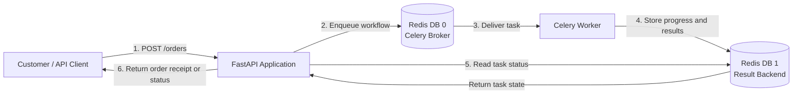
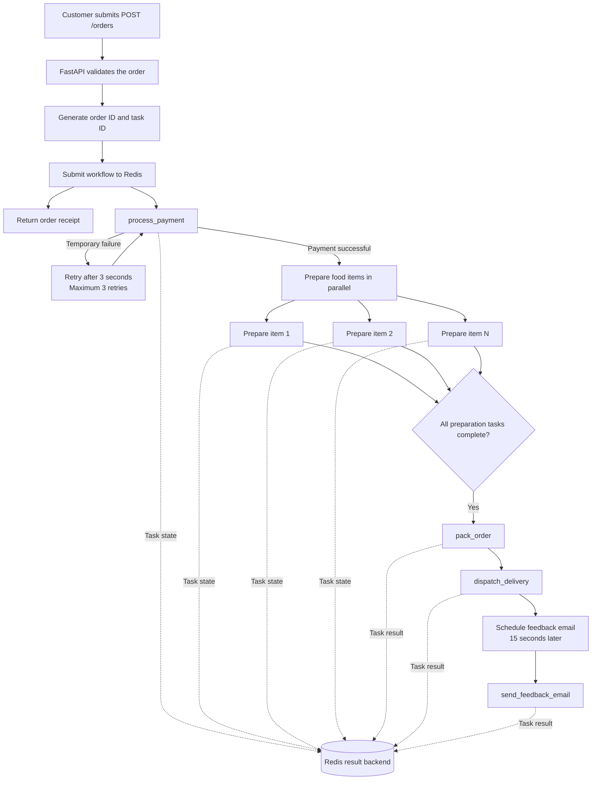
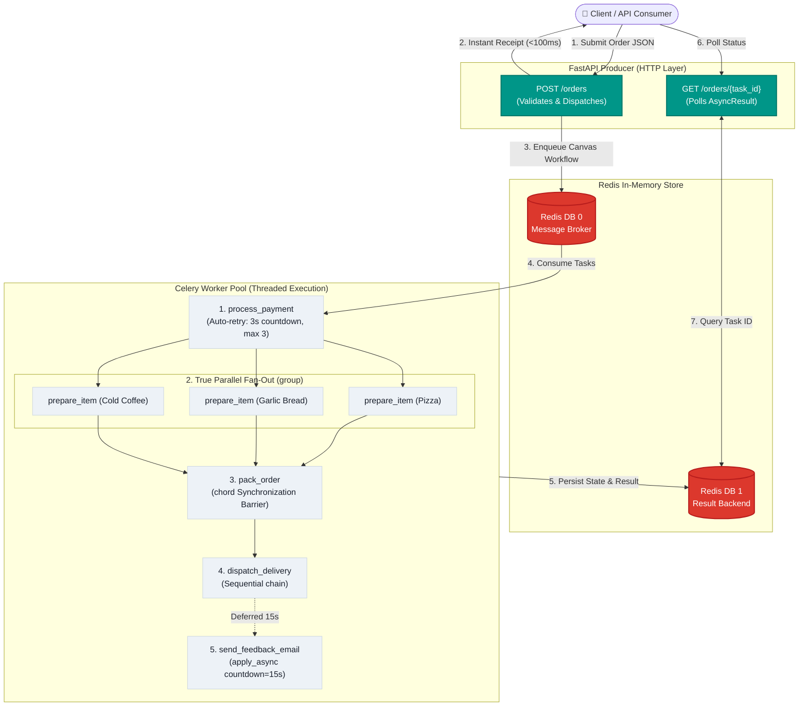

# Food Order Tracker \| FastAPI, Celery, Redis & Docker

[](https://www.python.org/)
[](https://fastapi.tiangolo.com/)
[](https://docs.celeryq.dev/)
[](https://redis.io/)
[](https://www.docker.com/)

A **distributed, asynchronous food order tracking system** built with
**Python, FastAPI, Celery, Redis, and Docker**. The API accepts an order
and quickly returns tracking identifiers, while Celery workers process
payment, prepare food items concurrently, pack the order, dispatch
delivery, and schedule a follow-up feedback email in the background.

> **Project focus:** asynchronous task processing, distributed task
> queues, parallel execution, workflow orchestration, retries, and
> background job status tracking.

------------------------------------------------------------------------

## Table of Contents

-   [Overview](#overview)
-   [Architecture](#architecture)
-   [Order Processing Workflow](#order-processing-workflow)
-   [Technology Stack](#technology-stack)
-   [Key Features](#key-features)
-   [Prerequisites](#prerequisites)
-   [Getting Started](#getting-started)
-   [API Documentation](#api-documentation)
-   [Example API Requests](#example-api-requests)
-   [Celery Task Orchestration](#celery-task-orchestration)
-   [Monitoring Task Status](#monitoring-task-status)
-   [Docker](#docker)
-   [Project Structure](#project-structure)
-   [Learning Outcomes](#learning-outcomes)
-   [Future Improvements](#future-improvements)

## Overview

The Food Order Tracker demonstrates how to move long-running work out of
an HTTP request/response cycle.

1.  A customer submits an order through the FastAPI endpoint.
2.  FastAPI validates the request and creates an order ID.
3.  The API sends the workflow to Celery through Redis and immediately
    returns a task ID.
4.  Celery workers execute the order-processing workflow asynchronously.
5.  Redis stores task state and results so the API can report progress
    to the client.

The background workflow includes payment processing with retries,
parallel food preparation, item aggregation and packing, delivery
dispatch, and delayed customer engagement.

## Architecture

### High-level system architecture



**Component responsibilities**

  -----------------------------------------------------------------------
  Component                           Responsibility
  ----------------------------------- -----------------------------------
  FastAPI                             Validates incoming orders, creates
                                      tracking identifiers, queues
                                      background work, and exposes
                                      order-status endpoints.

  Redis DB 0                          Acts as the Celery message broker
                                      and stores queued task messages.

  Celery worker                       Consumes queued work and executes
                                      the order workflow in the
                                      background.

  Redis DB 1                          Acts as the Celery result backend
                                      for task states and final results.

  Docker                              Provides a containerization layer
                                      for packaging and running the
                                      application services.
  -----------------------------------------------------------------------

### Detailed order-processing flow

The workflow uses Celery Canvas primitives to combine sequential steps
with parallel work.



## Order Processing Workflow

  -----------------------------------------------------------------------
  Stage                   Task                    What happens
  ----------------------- ----------------------- -----------------------
  1                       `process_payment`       Processes payment and
                                                  retries transient
                                                  failures after a
                                                  3-second countdown, up
                                                  to 3 retries.

  2                       `prepare_item`          Prepares each food item
                                                  as an independent task,
                                                  allowing parallel
                                                  execution.

  3                       `pack_order`            Waits for all
                                                  preparation tasks and
                                                  aggregates their
                                                  outputs into a packed
                                                  order.

  4                       `dispatch_delivery`     Receives the
                                                  packed-order summary
                                                  and dispatches the
                                                  order for delivery.

  5                       `send_feedback_email`   Runs as a delayed task
                                                  15 seconds after
                                                  delivery dispatch.
  -----------------------------------------------------------------------

## Technology Stack

-   **Language:** Python 3.9+
-   **API framework:** FastAPI
-   **ASGI server:** Uvicorn
-   **Task queue:** Celery
-   **Message broker:** Redis (Database 0)
-   **Task result backend:** Redis (Database 1)
-   **Containerization:** Docker
-   **API testing:** Postman or cURL

## Key Features

-   **Non-blocking order API:** returns an order receipt without waiting
    for the complete workflow.
-   **Asynchronous background processing:** Celery workers handle
    long-running operations outside the API request.
-   **Parallel task execution:** uses `group()` to prepare multiple food
    items concurrently.
-   **Workflow synchronization:** uses `chord()` to call the packing
    task after all parallel preparation tasks finish.
-   **Sequential task pipeline:** uses `chain()` to pass the
    packed-order result into delivery dispatch.
-   **Automatic task retries:** uses `bind=True`, `max_retries`, and
    `self.retry()` for transient payment failures.
-   **Delayed task scheduling:** uses `apply_async(countdown=15)` for
    post-delivery feedback.
-   **Task state and result tracking:** uses `AsyncResult(task_id)` with
    Redis as the result backend.

## Prerequisites

-   Python 3.9 or newer
-   Redis running and accessible at `localhost:6379`
-   Required Python packages: `fastapi`, `uvicorn`, `celery`, and
    `redis`
-   Docker, if you want to run the services in containers
-   Postman or cURL for testing the API

Redis is configured with two logical databases:

```text
redis://localhost:6379/0  # Celery message broker
redis://localhost:6379/1  # Celery result backend
```

## Getting Started

### 1. Clone the repository

```bash
git clone <YOUR_REPOSITORY_URL>
cd <YOUR_PROJECT_DIRECTORY>
```

Replace the placeholders with your Git repository URL and project
directory.

### 2. Create and activate a virtual environment

**Windows PowerShell**

```powershell
python -m venv venv
.\venv\Scripts\Activate.ps1
```

**macOS / Linux**

```bash
python3 -m venv venv
source venv/bin/activate
```

### 3. Install dependencies

```bash
pip install fastapi uvicorn celery redis
```

### 4. Start Redis

Start a Redis instance and confirm that it is listening on port `6379`.
The application expects the broker and result backend URLs shown above.

### 5. Start the Celery worker

Open a terminal in the project root and run:

```bash
celery -A tasks worker --loglevel=info --pool=threads --concurrency=4 -n worker1@%h
```

The thread pool is used in the supplied practice setup for
Windows-compatible worker execution.

### 6. Start the FastAPI server

Open another terminal and run:

```bash
uvicorn main:api --reload
```

The command assumes the FastAPI application instance is named `api` in
`main.py`.

### 7. Open the API documentation

Visit:

```text
http://127.0.0.1:8000/docs
```

Use the interactive Swagger UI to submit an order and check its status.

## API Documentation

  -----------------------------------------------------------------------
  Method                  Endpoint                Description
  ----------------------- ----------------------- -----------------------
  `POST`                  `/orders`               Submit a new food order
                                                  and start the
                                                  background workflow.

  `GET`                   `/orders/{task_id}`     Retrieve the Celery
                                                  task state and result
                                                  for an order workflow.
  -----------------------------------------------------------------------

### Place an order

**Endpoint:** `POST /orders`

**Content-Type:** `application/json`

Request body:

```json
{
  "customer_email": "rahul@example.com",
  "items": [
    "Margherita Pizza",
    "Garlic Bread",
    "Cold Coffee"
  ],
  "total_amount": 599.0
}
```

Example immediate response:

```json
{
  "order_id": "ORD-A1B2C3",
  "task_id": "9b1deb4d-3b7d-4bad-9bdd-2b0d7b3dcb6d",
  "message": "Order placed successfully. Tracking workflow initiated."
}
```

The identifiers above are illustrative. Your application will generate
its own IDs.

### Check order status

**Endpoint:** `GET /orders/{task_id}`

Use the `task_id` returned by `POST /orders`.

Example in-progress response:

```json
{
  "task_id": "9b1deb4d-3b7d-4bad-9bdd-2b0d7b3dcb6d",
  "state": "PENDING",
  "result": "Still in progress..."
}
```

Example successful response:

```json
{
  "task_id": "9b1deb4d-3b7d-4bad-9bdd-2b0d7b3dcb6d",
  "state": "SUCCESS",
  "result": {
    "order_id": "ORD-A1B2C3",
    "status": "DELIVERED",
    "details": "Order ORD-A1B2C3 packed with ['Margherita Pizza', 'Garlic Bread', 'Cold Coffee']"
  }
}
```

The exact response depends on the task state and the result returned by
your implementation.

## Example API Requests

Submit an order:

```bash
curl -X POST "http://127.0.0.1:8000/orders" \
  -H "Content-Type: application/json" \
  -d '{
    "customer_email": "rahul@example.com",
    "items": ["Margherita Pizza", "Garlic Bread", "Cold Coffee"],
    "total_amount": 599.0
  }'
```

Check its status (replace the task ID):

```bash
curl "http://127.0.0.1:8000/orders/<TASK_ID>"
```

You can also send the same requests through Postman.

## Celery Task Orchestration

This project demonstrates common Celery Canvas patterns:

  -----------------------------------------------------------------------
  Celery feature                      Role in this project
  ----------------------------------- -----------------------------------
  `chain()`                           Runs dependent workflow steps
                                      sequentially.

  `group()`                           Runs independent food-preparation
                                      tasks in parallel.

  `chord()`                           Waits for all tasks in a group
                                      before running the packing
                                      callback.

  `.si()`                             Creates an immutable task signature
                                      where required by the workflow.

  `self.retry()`                      Retries a task after a temporary
                                      failure.

  `apply_async(countdown=15)`         Schedules the feedback task for
                                      later execution.

  `AsyncResult(task_id)`              Reads the state and result
                                      associated with a task ID.
  -----------------------------------------------------------------------

## Monitoring Task Status

The status endpoint reads the task information using Celery's
`AsyncResult` and the Redis result backend.

Common Celery states include:

-   `PENDING` --- the task is waiting, or its state is not yet known to
    the result backend.
-   `STARTED` --- the worker has started executing the task (when
    started-state tracking is enabled).
-   `SUCCESS` --- the task completed successfully.
-   `FAILURE` --- the task raised an exception and failed.

Check the Celery worker terminal to follow payment, retry, parallel
preparation, packing, delivery, and feedback task logs.

## Docker

Docker is part of the project's technology stack and can be used to
package the API, worker, and Redis services as containers.

The supplied practice guide specifies the local Python/Uvicorn/Celery
startup commands, but does not define Dockerfile or Docker Compose
configuration. If your repository contains a `Dockerfile` and
`compose.yaml` (or `docker-compose.yml`), add the verified container
startup command here. For example, `docker compose up --build` is
appropriate only after a working Compose configuration has been added.

## Project Structure

The exact file layout depends on your repository. A possible
organization is:

```text
food-order-tracker/
├── main.py              # FastAPI application and order endpoints
├── tasks.py             # Celery app and background task definitions
├── requirements.txt     # Python dependencies
├── Dockerfile           # Container image definition (if included)
├── compose.yaml         # Multi-container setup (if included)
└── README.md
```

Adjust this tree to match the files that actually exist in your
repository.

## Learning Outcomes

By building this project, you can practice:

-   Designing a decoupled producer--broker--consumer architecture.
-   Building REST APIs with FastAPI.
-   Processing background jobs with Celery and Redis.
-   Combining sequential pipelines with parallel fan-out/fan-in
    workflows.
-   Handling transient failures with automatic task retries.
-   Scheduling delayed background jobs without blocking worker
    execution.
-   Tracking asynchronous task lifecycle states and results.
-   Understanding how Docker can package application services for
    repeatable deployment.

## Future Improvements

-   Add input validation and consistent error responses for invalid
    orders.
-   Add persistent order records in a database.
-   Add authentication and authorization for customer order tracking.
-   Add structured logging and health-check endpoints.
-   Add Docker Compose configuration with health checks and service
    dependencies.
-   Add automated tests for API endpoints and Celery tasks.
-   Add monitoring and metrics for queue length, task duration, retries,
    and worker health.

------------------------------------------------------------------------

## Keywords

`Food Order Tracking System` · `FastAPI Project` ·
`Python Backend Project` · `Celery Task Queue` · `Redis Message Broker`
· `Redis Result Backend` · `Asynchronous Processing` ·
`Background Tasks` · `Distributed Task Processing` · `Celery Canvas` ·
`Parallel Task Execution` · `Dockerized Python Application` · `REST API`
· `Microservices Architecture`

------------------------------------------------------------------------

**If you find this project useful, consider giving the repository a
star.**


# 🍕 Asynchronous Food Order Tracker: FastAPI, Celery, Redis & Docker

[](https://www.python.org/)
[](https://fastapi.tiangolo.com/)
[](https://docs.celeryq.dev/)
[](https://redis.io/)
[](https://www.docker.com/)

A high-throughput, **distributed Food Order Tracker** built with **Python, FastAPI, Celery, Redis, and Docker**. This repository serves as a reference architecture for modern **asynchronous microservices**, demonstrating non-blocking HTTP ingestion, real-time task state polling, fault-tolerant retries, and complex distributed workflow orchestration using **Celery Canvas** (`chain`, `group`, `chord`).

---

## 🏗️ System Architecture & Workflow

This project implements a decoupled **Producer-Broker-Consumer** architecture to ensure low API latency (< 100ms) while executing long-running, multi-stage background pipelines.



### Core Components
* **FastAPI (Producer):** High-throughput HTTP ingestion layer that validates incoming customer payloads, generates unique order/task IDs, dispatches Celery Canvas workflows, and immediately returns a receipt without blocking.
* **Redis (Broker & Result Backend):** Serves a dual role inside Docker—**Database 0** acts as the message broker queuing task signatures, while **Database 1** acts as the key-value result store tracking execution states (`PENDING`, `STARTED`, `SUCCESS`, `FAILURE`).
* **Celery Worker (Consumer):** Executes the distributed order fulfillment pipeline across isolated worker threads (`--pool=threads`), handling payment retries, parallel food prep, item aggregation, delivery dispatch, and deferred notifications.

---

## ✨ Key Engineering Patterns Demonstrated

| Engineering Concept | Technical Implementation | Architectural Value |
| :--- | :--- | :--- |
| **Decoupled Architecture** | FastAPI + Redis + Celery | Isolates web servers from heavy background processing, ensuring sub-100ms API response times. |
| **Canvas Orchestration** | `chain()`, `chord()`, `group()`, `.si()` | Expresses complex execution graphs combining sequential pipelines with parallel fan-out/fan-in patterns. |
| **Fault Resilience** | `bind=True`, `max_retries=3`, `self.retry()` | Self-healing recovery from transient payment gateway failures with a 3-second backoff countdown. |
| **Synchronization Barrier** | `chord` Callback (`pack_order`) | Blocks packing until the slowest parallel cooking task completes, aggregating all outputs into a single list. |
| **Deferred Execution** | `.apply_async(..., countdown=15)` | Dynamically schedules future post-delivery customer feedback emails without blocking worker threads or using cron jobs. |
| **Asynchronous State Tracking** | `AsyncResult(task_id)` + Redis DB 1 | Enables real-time lifecycle state polling and final JSON payload retrieval. |

---

## 🚀 Getting Started

### Prerequisites
* **Docker & Docker Compose** (Recommended for containerized execution)
* *Or for local execution:* Python 3.9+ and a running Redis instance on `localhost:6379`.

### 🐳 Quick Start with Docker (Recommended)

1. **Clone the repository:**
   ```bash
   git clone https://github.com/yourusername/fastapi-celery-redis-order-tracker.git
   cd fastapi-celery-redis-order-tracker
   ```

2. **Spin up the containers (FastAPI, Celery Worker, and Redis):**
   ```bash
   docker-compose up --build
   ```

3. **Access the Interactive API Docs:**
   Open your browser and navigate to `http://localhost:8000/docs` to test endpoints via Swagger UI.

---

### 💻 Local Development Setup (Without Docker)

If you prefer running services directly in your local Python environment:

1. **Install dependencies:**
   ```bash
   pip install fastapi uvicorn celery redis
   ```

2. **Start Redis Server** (Ensure Redis is accessible at `localhost:6379`).

3. **Start the Celery Worker** (Configured with a cross-platform, Windows-safe threaded execution pool):
   ```bash
   celery -A tasks worker --loglevel=info --pool=threads --concurrency=4 -n worker1@%h
   ```

4. **Start the FastAPI Application Server:**
   ```bash
   uvicorn main:api --reload
   ```

---

## 📡 API Reference & Usage

### 1. Place a New Order (`POST /orders`)
Submits a customer order payload and immediately triggers the asynchronous background pipeline.

* **Endpoint:** `POST /orders`
* **Request Payload:**
  ```json
  {
    "customer_email": "rahul@example.com",
    "items": [
      "Margherita Pizza",
      "Garlic Bread",
      "Cold Coffee"
    ],
    "total_amount": 599.0
  }
  ```
* **Immediate Response (`200 OK` in < 100ms):**
  ```json
  {
    "order_id": "ORD-A1B2C3",
    "task_id": "9b1deb4d-3b7d-4bad-9bdd-2b0d7b3dcb6d",
    "message": "Order placed successfully. Tracking workflow initiated."
  }
  ```

### 2. Track Order Status (`GET /orders/{task_id}`)
Polls the Redis Result Backend using the `task_id` UUID to monitor real-time fulfillment progress.

* **Endpoint:** `GET /orders/9b1deb4d-3b7d-4bad-9bdd-2b0d7b3dcb6d`
* **Response (While Processing):**
  ```json
  {
    "task_id": "9b1deb4d-3b7d-4bad-9bdd-2b0d7b3dcb6d",
    "state": "PENDING",
    "result": "Still in progress..."
  }
  ```
* **Response (Upon Completion):**
  ```json
  {
    "task_id": "9b1deb4d-3b7d-4bad-9bdd-2b0d7b3dcb6d",
    "state": "SUCCESS",
    "result": {
      "order_id": "ORD-A1B2C3",
      "status": "DELIVERED",
      "details": "Order ORD-A1B2C3 packed with ['Margherita Pizza', 'Garlic Bread', 'Cold Coffee']"
    }
  }
  ```

---

## 🔍 Observability & Worker Log Sequence

When an order is submitted, inspect your Celery worker logs to observe the distributed execution stages:

1. **Payment Processing (`process_payment`):** Attempts payment authorization. On simulated gateway errors, logs a warning and triggers a `3-second` retry countdown (`max_retries=3`).
2. **Parallel Cooking (`prepare_item`):** All items (`Margherita Pizza`, `Garlic Bread`, `Cold Coffee`) enter the `STARTED` state at the **exact same timestamp** across concurrent threads, finishing independently (2–5s).
3. **Aggregation & Packing (`pack_order`):** Executes only after the slowest cooking task finishes, bundling all items into a single package.
4. **Delivery Dispatch (`dispatch_delivery`):** Receives the packed summary via `chain`, hands off to the courier, and schedules the follow-up task.
5. **Delayed Engagement (`send_feedback_email`):** Fires exactly **15 seconds** after delivery dispatch without blocking active worker threads.

---

## 🛠️ Tech Stack
* **Backend Framework:** Python 3.9+, FastAPI, Uvicorn
* **Distributed Task Queue:** Celery (Canvas Primitives: `chain`, `group`, `chord`)
* **Message Broker & Cache:** Redis (DB 0 Broker / DB 1 Result Backend)
* **Containerization:** Docker & Docker Compose
